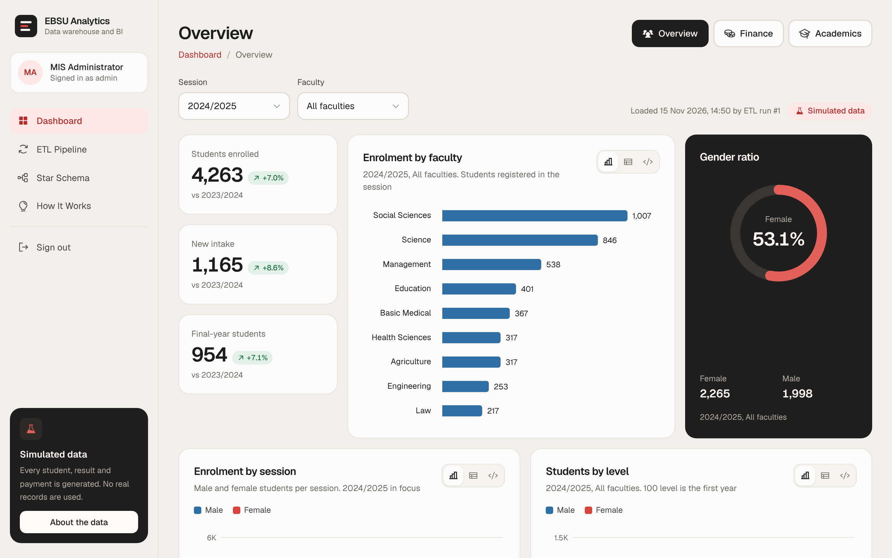

# EBSU Data Warehouse and BI Dashboard

**Design and Implementation of a Data Warehouse and Business Intelligence Dashboard for University Administration.** A B.Sc. Computer Science final-year project for Ebonyi State University (EBSU), Abakaliki.

> **All student, fee and result data in this repository is simulated.** No real student or staff record is used anywhere. Faculty and department names, acceptance fees and the grading scale are EBSU's published values; every person, score and payment is generated by `warehouse/generator/generate_data.py`, and every matric number contains `SIM` (for example `EBSU/SIM/2021/0085400`).



Three simulated source systems (Admissions & Records, Bursary, Examinations & Records) export CSV files. A Python/pandas ETL cleans them and loads a MySQL star schema. A Next.js dashboard answers the Vice-Chancellor's, the Bursar's and the Deans' questions, filtered by session and faculty. Everything runs on one laptop, offline.

| What the brief asked for | Where it is |
|---|---|
| Admin login stored in MySQL | `app_admin` table (salted scrypt hash); login page |
| A button that runs the ETL and shows rows loaded per source | ETL Pipeline page, **Run ETL** |
| Star schema diagram viewable | Star Schema page (drawn live from the database); `docs/diagrams/star-schema.png` |
| Overview, Finance and Academics tabs, filtered by session and faculty | Dashboard |
| One command after XAMPP is started | `start.bat` (Windows) or `npm start` |
| Data generator shipped | `warehouse/generator/` |
| Project document, 10-slide deck, Q&A sheet | `docs/project/`, `docs/defense/` |

## Quick start (Windows and XAMPP)

1. Install [XAMPP](https://www.apachefriends.org/) (only MySQL is used), [Node.js](https://nodejs.org/) 20.9 or later, and [Python](https://www.python.org/downloads/) 3.9 or later. On the Python installer, tick **Add python.exe to PATH**.
2. Open the XAMPP Control Panel and click **Start** next to MySQL.
3. Double-click **`start.bat`** in this folder (or run `npm start` in a terminal; on Linux or macOS, `./start.sh`).
4. The dashboard opens in your browser, usually at http://localhost:3000. Sign in with:
   - username: `admin`
   - password: `ebsu-dw-2025`

The first start needs the internet, to download the npm and pip packages. It takes a few minutes and does everything else for you:

1. checks Node.js, and creates `.env.local` with a random session secret;
2. installs the npm packages if they are missing;
3. creates a Python virtual environment (`.venv`) with pandas and PyMySQL;
4. generates the simulated CSV files if they are missing;
5. waits for MySQL, creates the `ebsu_dw` database and runs the ETL if the warehouse is empty;
6. creates the admin login;
7. builds the dashboard if the code has changed, picks a free port from 3000, starts the server and opens the browser.

Later starts take a few seconds and need no internet.

## Working offline

After the first start, turn Wi-Fi off: the dashboard, the ETL and the data are all local. Fonts (Geist) and icons (Phosphor) are bundled, and no page loads anything from the internet. Before a demo, run:

```
npm run check
```

It reports on Node.js, Python, the packages, the data files, the build, MySQL, the warehouse and the login, and changes nothing. Every line should say `OK`.

**A seven-minute demo:** sign in → Overview (switch the session) → Finance (choose a faculty to drill down to departments) → Academics (open a chart's SQL view) → ETL Pipeline (**Run ETL**, then read the rows by source and the rejected rows) → Star Schema (click `fact_result`) → How It Works ("Why not just use Excel?" with the live benchmark). The defence Q&A sheet has the full script.

## Commands

| Command | What it does |
|---|---|
| `npm start` | Prepares whatever is missing, then starts the dashboard (`--dev`, `--no-open` and `--port 3001` are accepted after `--`) |
| `npm run check` | Pre-demo check; changes nothing |
| `npm run etl` | Runs the ETL in the terminal and prints its log |
| `npm test` | Runs the 15 ETL tests (no database needed) |
| `npm run generate-data` | Regenerates the simulated CSV files |
| `npm run reset` | Drops the warehouse database and loads it again from the CSV files |
| `npm run reset-admin` | Resets the login to `ADMIN_USERNAME` / `ADMIN_PASSWORD` from `.env.local` |
| `npm run setup` | Does everything `npm start` does except starting the server |
| `npm run typecheck` | TypeScript check of the dashboard |

## How it fits together

```
admissions.csv ──┐
bursary.csv ─────┤
exams.csv ───────┼──► ETL ──────────► MySQL warehouse ──► Next.js dashboard ──► Vice-Chancellor,
departments.csv ─┘    Python, pandas   star schema         Overview, Finance,     Bursar, Deans
                                       (ebsu_dw)           Academics
```

**Star schema** (a galaxy of three stars sharing five conformed dimensions):

| Fact table | Grain: one row is… | Measures |
|---|---|---|
| `fact_enrolment` | one student registered in one session | `enrolment_count`, `is_new_entrant`, `level` |
| `fact_fee_payment` | one fee item billed to one student in one session | `amount_billed`, `amount_paid`, `amount_outstanding` |
| `fact_result` | one student's result in one course in one session | `ca_score`, `exam_score`, `total_score`, `grade_point`, `credit_units`, `quality_points`, `is_pass` |

Dimensions: `dim_student`, `dim_course`, `dim_department`, `dim_faculty`, `dim_session`, joined to the facts by 13 foreign keys. CGPA is always computed as Σ quality points ÷ Σ credit units, never by averaging GPAs.

**ETL** (`warehouse/etl/etl.py`): reads the three exports and the official department list; applies 20 cleaning rules (matric numbers, session labels, dates, gender, naira amounts, course codes, department names); removes duplicates on each grain's natural key; rejects rows that cannot be trusted, with the reason; loads shadow tables, checks row counts and all 13 foreign keys, then swaps the eight tables in with one atomic `RENAME TABLE`. A failed run leaves the live data untouched. Every run is recorded in `etl_run`, `etl_run_source`, `etl_run_table`, `etl_run_rule` and `etl_reject`.

On the simulated data: 206,885 rows extracted = 206,321 loaded + 478 duplicates + 86 rejected. A full run takes about 5 to 6 seconds.

## Project layout

```
start.bat, start.sh          one-command start
scripts/start.mjs            the runner behind npm start / check / etl / test (Node built-ins only)
warehouse/
  generator/                 synthetic data generator (standard library only, fixed seed)
  data/sources/              admissions.csv, bursary.csv, exams.csv (simulated)
  data/reference/            departments.csv (EBSU's faculties and programmes)
  sql/schema.sql             warehouse, audit and login tables
  etl/etl.py                 the ETL
  tests/test_etl.py          unit and reconciliation tests
src/
  app/                       Next.js pages: login, dashboard tabs, ETL, schema, How It Works, ETL API route
  components/                charts, schema explorer, ETL runner, layout
  lib/                       database pool, session, filters, SQL queries for each page
docs/
  project/                   draft project report (.docx and .pdf, five chapters)
  defense/                   10-slide deck (.pptx and .pdf) and Q&A sheet (.docx and .pdf)
  diagrams/                  report diagrams (PNG) and their source (src/diagrams.html)
  screenshots/               dashboard screenshots used in the report and deck
  DECISIONS.md               decision log
```

## Configuration

`.env.local` is created from `.env.example` on the first start. Defaults match a fresh XAMPP install.

| Key | Default | Meaning |
|---|---|---|
| `DB_HOST` | `127.0.0.1` | MySQL host. Use `127.0.0.1` rather than `localhost` on Windows. |
| `DB_PORT` | `3306` | MySQL port |
| `DB_USER` / `DB_PASSWORD` | `root` / empty | MySQL account |
| `DB_NAME` | `ebsu_dw` | Warehouse database (created automatically) |
| `ADMIN_USERNAME` / `ADMIN_PASSWORD` | `admin` / `ebsu-dw-2025` | Dashboard login, created on first start |
| `SESSION_SECRET` | random | Signs the login cookie |
| `PYTHON_BIN` | `.venv` Python | Python used by the Run ETL button |

## Troubleshooting

| Problem | Fix |
|---|---|
| "Database offline" in the dashboard | Start MySQL in XAMPP and refresh the page. |
| MySQL will not start in XAMPP | Port 3306 is taken by another MySQL service. Stop it, or set `DB_PORT` in `.env.local`. |
| Python not found | Reinstall Python with **Add python.exe to PATH** ticked, then run `npm start` again. |
| First start fails while downloading | Connect to the internet and run `npm start` again; it carries on where it stopped. |
| Forgotten password | `npm run reset-admin` |
| Port 3000 busy | Nothing to do: the next free port is used and printed. |

## Tests

`npm test` runs `python -m unittest discover -s warehouse/tests -v`: seven tests check the cleaning rules on known inputs, and eight run the real transformation on the full simulated files and check that every source row is accounted for, that each fact table's grain is unique, that every foreign key finds its dimension, that the fee and score arithmetic holds and that every CGPA lies between 0 and 5. Tested with pandas 2.2 and 3.0 on MariaDB 10.11.

## Documents

- `docs/project/EBSU_DW_BI_Project_Draft.docx`: the draft report (Chapters One to Five, references, appendices). Yellow highlights mark everything you must fill in or check: your name and matric number, the supervisor, interviews, the usability test results and the reference details. After editing, right-click the table of contents and choose **Update Field**.
- `docs/defense/EBSU_DW_Defense_Deck.pptx`: ten slides with speaker notes.
- `docs/defense/EBSU_DW_Defense_QA.docx`: answers to the panel's questions, each with the screen to show.
- `docs/DECISIONS.md`: every decision taken while building the project, and what could not be produced.

## Credits

Built with Next.js, React, Recharts, Tailwind CSS, mysql2, pandas and PyMySQL. Icons: [Phosphor](https://phosphoricons.com/) (MIT). Font: [Geist](https://vercel.com/font) (SIL Open Font License). The EBSU name is used only to describe the case study; no EBSU logo or crest is used.
